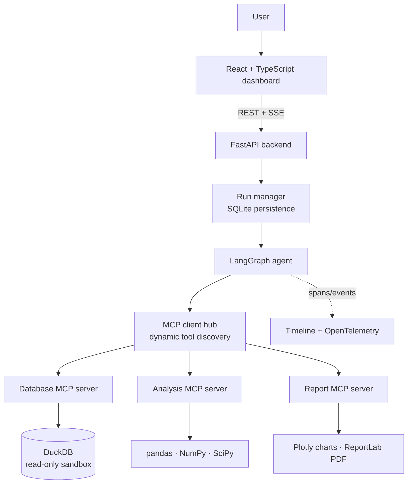
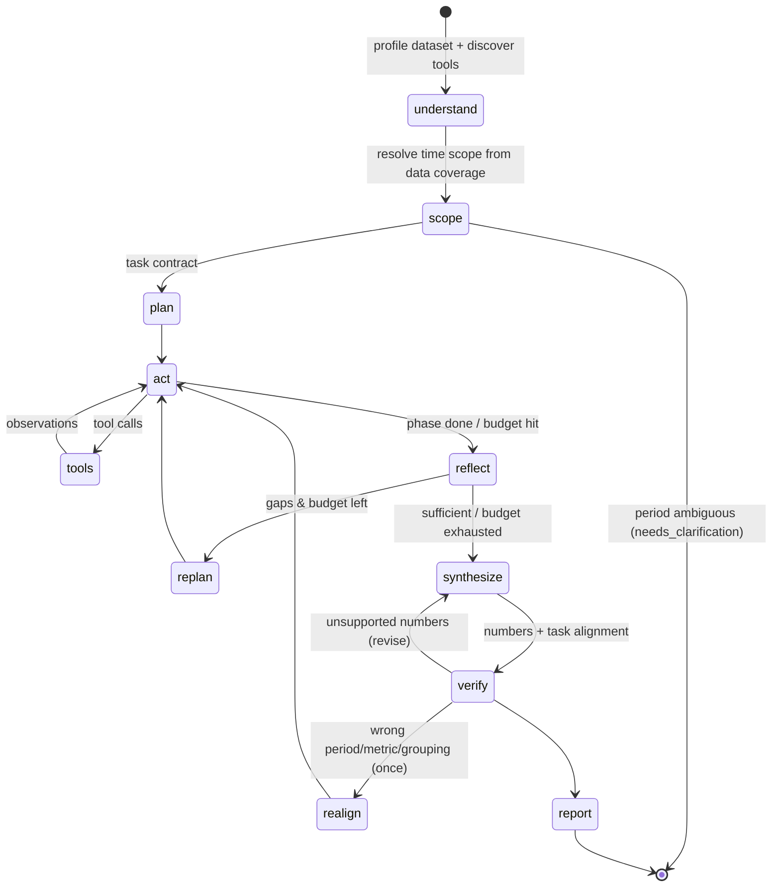

# Queryra

**An autonomous, MCP-powered data analyst.** Upload a dataset, ask a question in plain English
("*Why did revenue decline last quarter, and which customer segments contributed most?*"), and
Queryra plans an investigation, discovers its tools over the Model Context Protocol, runs SQL and
statistical tests, re-plans when the evidence is incomplete, checks every number it reports against
the actual tool outputs, and hands you a PDF report.

Live demo: **https://queryra.vercel.app**

> Queryra was developed as *DataBeacon*. Internal identifiers keep that name so existing
> configuration keeps working: the Python package `databeacon`, the `DATABEACON_*` environment
> variables and the `X-DataBeacon-*` request headers.

Every decision, LLM call, tool call and SQL query is visible in a live **Agent Execution Timeline**.


---

## Contents

- [What it does](#what-it-does)
- [Architecture](#architecture)
- [Quick start](#quick-start)
- [Getting a free Cloudflare Workers AI key](#getting-a-free-cloudflare-workers-ai-key)
- [How the agent works](#how-the-agent-works)
- [MCP servers](#mcp-servers)
- [Evidence verification](#evidence-verification)
- [Temporal scoping](#temporal-scoping)
- [Task alignment](#task-alignment)
- [Token efficiency](#token-efficiency)
- [Security model](#security-model)
- [Evaluation framework](#evaluation-framework)
- [Observability](#observability)
- [REST API](#rest-api)
- [Configuration](#configuration)
- [Project layout](#project-layout)
- [Development](#development)

---

## What it does

| Capability | How |
|---|---|
| **Dataset understanding** | Automatic profiling: semantic column roles (numeric / categorical / temporal / identifier), missing values, distinct counts, quartiles, IQR outliers, strong correlations, data-quality warnings |
| **Autonomous planning** | The LLM turns the question into falsifiable hypotheses, concrete date ranges and ordered steps (structured output) |
| **MCP tool discovery** | At the start of each run the agent connects to three MCP servers and lists their tools, resources and prompts. Nothing in the loop is hard-coded to a tool |
| **Tool execution** | ReAct-style tool calling over read-only SQL, hypothesis tests, anomaly detection, trend analysis and change attribution |
| **Dynamic replanning** | After each phase a reflection step judges whether the evidence answers the question. If not, it lists the gaps and the agent goes back to work |
| **Evidence verification** | Every number in every finding is checked against real tool outputs. Unsupported claims trigger an automatic revision |
| **Visualisation** | Interactive Plotly charts built from SQL queries, so each chart is evidence too |
| **Reporting** | A PDF (ReportLab) with summary, verified findings, charts, limitations, an evidence appendix with SQL, and the execution timeline |
| **Observability** | Live timeline over Server-Sent Events, OpenTelemetry spans, token and latency accounting |
| **Evaluation** | A benchmark suite that scores task success, SQL accuracy against gold queries, tool-selection F1, numerical accuracy, hallucination rate, latency and tokens |

It costs $0 to run: open-source stack, DuckDB/SQLite storage, and a free-tier LLM (Cloudflare Workers AI by default; Groq or a local model also work).

## Architecture



The agent graph:



## Deployment

See [DEPLOYMENT.md](DEPLOYMENT.md) for:
- the public-deployment readiness audit;
- `DATABEACON_PUBLIC_MODE`: per-visitor isolation, rate limits, retention and an optional access code;
- the $0 hosted architecture: Vercel Hobby (frontend + Python function) + Cloudflare D1 (shared
  datasets, runs, events, rate limits, neuron ledger) + Cloudflare Workers AI;
- inline serverless execution, and the difference between reconnecting to saved progress and an
  interrupted run;
- replay mode (recorded investigations, no neurons);
- what is verified, what still needs a real deploy, and the exact Cloudflare and Vercel setup.

## Quick start

### Docker (single container, UI + API)

```bash
cp .env.example .env
```

Put your Cloudflare token and account ID into `.env` (see the next section), then:

```bash
docker compose up --build
```

Open http://localhost:8000, click **Load sample e-commerce data**, pick an example question and hit **Run analysis**.

### Local development

Backend (Python 3.11+):

```bash
cd backend
pip install -r requirements-dev.txt
export CLOUDFLARE_API_TOKEN=... CLOUDFLARE_ACCOUNT_ID=...
uvicorn databeacon.api.main:app --reload --port 8000
```

Frontend (Node 20+), in another terminal:

```bash
cd frontend
npm install
npm run dev
```

The dev UI runs on http://localhost:5173 and proxies `/api` to the backend.

**No API key yet?** Start the backend with `DATABEACON_LLM_PROVIDER=scripted` to try the whole UI
with a deterministic offline policy written for the bundled sample dataset.

## Getting a free Cloudflare Workers AI key

1. Sign in at [dash.cloudflare.com](https://dash.cloudflare.com) (a free account is fine).
2. Open **My Profile → API Tokens → Create Token**.
3. Pick the **Workers AI** template and click **Use template**.
4. Under **Account Resources**, select your account, then **Continue to summary → Create Token**.
5. Copy the token straight away; Cloudflare shows it only once. This is `CLOUDFLARE_API_TOKEN`.
6. Your **Account ID** is in the right-hand sidebar of the account overview page, or in the dashboard
   URL (`dash.cloudflare.com/<ACCOUNT_ID>/...`). This is `CLOUDFLARE_ACCOUNT_ID`.

Queryra calls Workers AI through its OpenAI-compatible endpoint
(`/client/v4/accounts/<id>/ai/v1/chat/completions`) and uses **`@cf/openai/gpt-oss-120b`** by default,
which supports native tool calling. Override it with `DATABEACON_MODEL`.

### Staying inside the free tier

Workers AI's free allocation is **10,000 neurons per day**. Cloudflare documents a reset at 00:00 UTC,
but we saw the allocation still exhausted after midnight by the previous evening's usage. So by default
Queryra counts usage over a **rolling 24 hours** (`DATABEACON_NEURON_WINDOW=rolling24h`; `utc_day`
for calendar days). It keeps a timestamped ledger (`<data dir>/llm_usage.sqlite`) of the neurons
Cloudflare reports with every response,
and refuses a Cloudflare call unless its **worst-case cost** (the prompt plus the full output allowance)
still fits under `DATABEACON_CLOUDFLARE_DAILY_NEURONS` (default 9,000). Reservations are atomic, so
concurrent runs cannot jointly overshoot.

Once the budget is reached, a run either uses the fallback provider or fails with a clear
"budget reached" message. The guard fails closed:
- if the ledger cannot be read, Cloudflare is not called;
- the budget cannot be set above the 10,000 free allocation unless `DATABEACON_ALLOW_PAID_INFERENCE=1`.

If Cloudflare itself reports the allocation exhausted (HTTP 429 with error 4006), the call fails at once
and Cloudflare is blocked for an hour rather than retried. The CI live-evaluation job only runs when
started by hand, and `evals.run --max-neurons N` caps a
benchmark run. `GET /api/usage` shows today's spend. The ledger is per data directory, so processes
that should share one budget must share `DATABEACON_DATA_DIR`.

For `gpt-oss-120b`, 1M input tokens cost 31,818 neurons and 1M output tokens cost 68,182 neurons.
Measured before the token optimisations: one analysis used **1,500–3,000 neurons** (40–80k tokens).
On the same trajectory the current prompts send about 30% fewer input tokens (see
[Token efficiency](#token-efficiency)). That's still only a handful of analyses per day on the free tier.
Lower `DATABEACON_MAX_TOOL_CALLS` or set `DATABEACON_REASONING_EFFORT=low` to fit more.

Workers AI defaults to **256 output tokens** per response. That is too few for a reasoning model:
the hidden reasoning can use all of it and leave an empty answer. Queryra sets
`DATABEACON_MAX_OUTPUT_TOKENS` (default 4096) on every request.

### Fallback and other providers

| Provider | Variables |
|---|---|
| Cloudflare Workers AI (primary) | `CLOUDFLARE_ACCOUNT_ID` + `CLOUDFLARE_API_TOKEN` |
| Groq (fallback or primary) | `DATABEACON_FALLBACK_PROVIDER=groq` + `GROQ_API_KEY` (model `openai/gpt-oss-120b`, override with `DATABEACON_FALLBACK_MODEL`) |
| Any OpenAI-compatible server (Ollama, vLLM, LM Studio…) | `DATABEACON_LLM_PROVIDER=openai`, `DATABEACON_LLM_BASE_URL`, `DATABEACON_MODEL` |
| Offline demo | `DATABEACON_LLM_PROVIDER=scripted` |

With a fallback configured, each LLM call tries Cloudflare first. It moves to the fallback when
Cloudflare errors or the neuron budget is spent. The timeline records which provider served each call.

If your deployment sits behind an egress proxy that injects the `Authorization` header, leave the
token variables empty and set `DATABEACON_INJECTED_AUTH=1`. Queryra then sends a placeholder and
never reads a token.

## How the agent works

The orchestration lives in [`backend/databeacon/agent/graph.py`](backend/databeacon/agent/graph.py) as a LangGraph `StateGraph`.

1. **understand**: calls `profile_dataset` over MCP and records the tool catalogue the hub discovered.
2. **scope** (deterministic, no LLM): resolves the question's time phrase against the data's coverage
   (see [Temporal scoping](#temporal-scoping)). If the period cannot be determined reliably, the run stops
   with `needs_clarification` and concrete options, before any tokens are spent.
3. **plan**: structured output (`Plan`: objective, question type, metric column, aggregation, grouping,
   answer target, hypotheses, steps). Plan and scope together form the **task contract**: metric,
   grouping and exact `[start, end)` periods. The contract is put in every later prompt.
4. **act ⇄ tools**: the LLM is bound to the discovered MCP tools (the `dataset_id` argument is injected
   by the client and hidden from the model). Every tool result becomes a numbered piece of evidence
   (`E1`, `E2`, …) and goes back to the model in compact form.
5. **reflect**: structured `Reflection` (sufficient? hypothesis status, gaps, next actions).
6. **replan**: if the evidence is not sufficient and budget remains, the gaps and a ledger of queries
   already run are fed back, and a new iteration starts.
7. **synthesize**: structured `Synthesis`: summary, findings with evidence ids, limitations,
   recommendations, and a machine-checkable `answer` (primary entity, dimension, metric, direction,
   periods, key value, evidence ids).
8. **verify**: deterministic, no LLM. Two independent checks:
   [number verification](#evidence-verification) and [task alignment](#task-alignment).
   - Misaligned: the agent is sent back once to collect the right evidence (**realign**).
   - Unsupported numbers or remaining misalignment: it revises the answer.
   - Still misaligned after that: the run ends as `completed_with_issues`, never as a plain success.
9. **report**: the report MCP server renders the PDF. If the agent made no chart, one is generated
   from the best tabular evidence.

**Reliability guardrails**

- Stopping conditions: max iterations, max tool calls overall, max tool-calling turns per phase.
- Duplicate tool calls are blocked and pointed at the existing evidence id.
- Tool errors (bad SQL, unknown column, …) are returned to the model with the database's message, so
  it can correct itself. The evaluation tracks the recovery rate.
- Unknown tools and hallucinated arguments are rejected or stripped before they reach a server.
- Tool calls emitted as JSON text by weaker open models are recovered into real tool calls.
- Rate limits and transient provider errors are retried with backoff, honouring "try again in Xs" hints.
- Older tool outputs are compacted to keep prompts inside small free-tier context limits.
- LLM failures during a phase do not kill the run; the agent continues with the evidence it has.

## MCP servers

Three independent servers built with the official MCP Python SDK. By default they run in-process; set
`DATABEACON_MCP_TRANSPORT=stdio` to run them as subprocesses, which is exactly how any other MCP
client would use them. [`mcp.example.json`](mcp.example.json) shows how to register them with a
desktop MCP client.

| Server | Tools | Resources / prompts |
|---|---|---|
| **databeacon-database** | `list_tables`, `profile_dataset`, `run_sql`, `sample_rows`, `column_values` | `datasets://catalog`, `dataset://{id}/schema`; prompts `sql_style_guide`, `hypothesis_prompt` |
| **databeacon-analysis** | `descriptive_statistics`, `correlation_analysis`, `compare_groups` (Welch t / Mann-Whitney / ANOVA / Kruskal-Wallis + effect sizes), `chi_square_test`, `detect_anomalies` (z-score / IQR / MAD), `trend_analysis` (OLS slope, Mann-Kendall, change point), `period_comparison` (change attribution by dimension) | prompt `choose_test` |
| **databeacon-report** | `create_chart` (Plotly), `generate_pdf_report` (ReportLab) | `reports://list`; prompt `report_outline` |

Run one on its own:

```bash
cd backend && python -m databeacon.mcp_servers.analysis
```

## Evidence verification

[`agent/verifier.py`](backend/databeacon/agent/verifier.py) pulls every quantitative claim out of
each finding (currency, thousands separators, `K/M/B` suffixes, percentages, percentage points), skips
years, quarter labels, ISO dates and small counts, then looks for each value:

- **directly** in the outputs of any successful tool call, with rounding-aware tolerance, or
- **derived** (difference, ratio, % change, ×100) from the values in the evidence the finding cites.

Derived matching is limited to *cited* evidence on purpose. Across a large pool of numbers almost any
value can be "derived", so the restriction keeps the check honest.

Each finding ends up `verified`, `partially_verified`, `unverified` or `qualitative`. The run reports a
**hallucination rate**: unsupported numeric claims ÷ all numeric claims.

## Temporal scoping

[`agent/temporal.py`](backend/databeacon/agent/temporal.py) resolves phrases like "last quarter",
"this month", "past 6 months", "Q3 2025 vs Q2 2025", "December 2025" or "year over year" against the
**data's coverage**, not the wall clock:

- The reference point is the latest date in the chosen date column. A calendar period counts as
  complete only if the data reaches its last day. The tolerance is one sampling interval, so weekly
  data, or monthly data stored as the first of each month, is handled.
- If the latest period is partial but barely started (under a third covered), "last quarter" means
  the last complete quarter, and that assumption is recorded.
- Every assumption ("data covers X to Y", "Q1 2026 is 11% covered and excluded", "comparison period:
  Q3 2025") appears in the task contract, the UI and the PDF.

**It asks instead of guessing** (status `needs_clarification`, with options) when:
- the latest period is partial but substantially covered;
- several date columns could apply and the question names none;
- the question has a time phrase but the data has no dates;
- a requested period is outside the data;
- a "change" question has no earlier period to compare with.

Answering re-runs the question with `clarification` (e.g. `"Q4 2025"` or
`"2025-10-01 to 2025-12-31"`). The UI shows one-click options.

## Task alignment

[`agent/alignment.py`](backend/databeacon/agent/alignment.py) checks that the work answers the question
that was asked, independently of whether its numbers are correct:

| Check | Fails when |
|---|---|
| Period | The answer's periods differ from the contract; no cited evidence queried the current period; cited evidence analyses dates outside the requested window; or the text discusses other periods (e.g. "Q2 2025") |
| Metric | The answer or its cited evidence uses a different metric column |
| Grouping | The answer is grouped by a different column, or no cited evidence is grouped as requested |
| Primary conclusion | The answer names no entity; or recomputing the extreme value from the cited evidence (period comparison, group comparison, or one-row-per-group SQL result) gives a different entity; or the summary doesn't state it |

This catches the failure seen on Cloudflare, where Q3 was compared with Q2 instead of Q4 with Q3. All
the numbers were correct for the wrong period, so number verification alone passed it.

## Token efficiency

Per-stage and per-component token use is recorded for every LLM call, and runs report
`tokens_by_stage`. Profile a run with:

```bash
cd backend && python -m evals.token_profile
```

Changes made after profiling a real 82k-token Cloudflare run, where act calls were 75% of tokens:

- Tool schemas no longer include tools the loop never needs to choose (`profile_dataset`,
  `list_tables`, `generate_pdf_report`). Descriptions are capped and `title`/`Optional` noise is
  removed. Result: about 20% less per act call.
- Tool results sent to the model are tool-aware digests: top contributors, ≤15 rows, float noise
  rounded. Result: about 64% smaller on the real run's evidence. Full results stay as evidence.
- Act history is compacted at 9k instead of 14k characters. The two latest results stay verbatim.
- Plan, reflect and synthesize use a brief system prompt without the tool rules. The profile is never
  re-sent as evidence.
- Repeated SQL is blocked modulo whitespace and case. Replans see a ledger of queries already run. The
  model is told it may batch independent tool calls.

Projected on the real run's trajectory, input tokens drop by about **30%** (≈62k → ≈44k). Fewer turns
from blocked or batched calls would save more, but that hasn't been measured live yet. Output tokens,
mostly gpt-oss reasoning in reflect, are unchanged.

## Security model

- **SQL sandbox** ([`sql_guard.py`](backend/databeacon/sql_guard.py)): one statement only; DuckDB's own
  parser must classify it as a `SELECT`; table functions that touch files or the network
  (`read_csv`, `read_parquet`, `glob`, …), `getenv` and URL schemes are denied.
- **Read-only execution**: queries run on a connection opened with `read_only=True`,
  `enable_external_access=false`, a 1 GB memory cap and 2 threads.
- **Resource limits**: row cap (outer `LIMIT`), wall-clock timeout that interrupts the query, upload
  size limit, run concurrency limit, per-run tool budgets.
- **Input validation**: Pydantic models for every request, sanitised identifiers and filenames, ISO
  date validation and quoted identifiers in generated SQL, strict id formats on file-serving routes.

## Evaluation framework

[`backend/evals`](backend/evals) runs the real agent end to end on a benchmark of questions about the
synthetic e-commerce dataset. The data has a known story planted in it: Q4-2025 revenue drops,
Enterprise is the segment that fell most, SMB customers in the West nearly stop ordering, and
Electronics discounts jump from about 8% to 22%. Gold entities and numbers are computed by SQL at
evaluation time.

A case **succeeds only if every check passes**. Each check is scored independently:

| Check | Passes when |
|---|---|
| Primary conclusion | The structured `answer.primary_entity` is the gold entity and the summary states it. Mentioning the right entity somewhere is not enough. |
| Period | `answer.current_period` / `previous_period` equal the gold periods |
| Metric / grouping | `answer.metric_column` / `answer.dimension` equal the gold ones |
| Numerical evidence | The gold numbers appear in the evidence the answer cites |
| Alignment | The agent's own task-alignment check passed |
| Hallucination | ≤ 10% of numeric claims unsupported |

Also reported: SQL validity, tool-selection F1, error recovery, trajectory (replans, realignments,
revisions, blocked duplicates), latency, tokens by stage, and Cloudflare neurons per case.

**Scorer calibration.** The offline suite includes scripted runs that are wrong on purpose:
- one investigates the wrong quarter and never corrects itself;
- one names the wrong segment while still mentioning the right one;
- one starts on the wrong quarter and must self-correct.

The scorer must fail the first two and pass the third. CI requires 100% calibration.

```bash
cd backend
python -m evals.run --mode scripted --min-calibration 1.0             # offline, incl. calibration (CI)
python -m evals.run --case revenue_decline_attribution --max-neurons 3500   # one live case, capped
python -m evals.run --max-neurons 7000                                 # live benchmark, capped
python -m evals.run --max-neurons 7000 --prior-spend 3500 --reuse-run return_rate=<run_id>   # resume
```

Live results go to `evals/results/latest.json`/`.md`, offline ones to `latest_scripted.*`. Both show up
in the **Evaluation** tab. Results from the earlier, lenient scorer are kept as
`legacy_lenient_scorer_*` for history. The `live-eval` CI job only runs when started manually.

## Observability

- **Timeline**: every node, LLM call (with token usage), tool call (with server, arguments, SQL,
  evidence id, duration), decision (replan, stop, revise) and guardrail event is streamed to the UI
  over SSE and stored with the run.
- **OpenTelemetry**: each step is also a span (`databeacon.run_id`, step type, status, token counts).
  Set `OTEL_EXPORTER_OTLP_ENDPOINT` (and install `opentelemetry-exporter-otlp`) to ship them to Jaeger,
  Tempo, Honeycomb and similar, or `DATABEACON_OTEL_CONSOLE=1` to print them.
- **Run metrics**: latency, LLM calls, tokens, tool calls/errors and SQL count per run.

## REST API

Interactive docs at `/docs` when the backend is running.

| Method | Path | Purpose |
|---|---|---|
| GET | `/api/health` | Version, LLM provider/model, MCP transport |
| GET / POST | `/api/datasets` | List / upload (multipart: CSV, TSV, Parquet, JSON, XLSX) |
| POST | `/api/datasets/sample` | Load the bundled e-commerce dataset |
| GET / DELETE | `/api/datasets/{id}` | Metadata / delete |
| GET | `/api/datasets/{id}/profile` | Full profile |
| POST | `/api/datasets/{id}/sql` | Read-only SQL console (same sandbox as the agent) |
| GET | `/api/mcp/catalog` | Discovered MCP tools, resources and prompts |
| POST | `/api/runs` | Start an analysis `{dataset_id, question, clarification?}` → `{run_id}` |
| GET | `/api/usage` | Today's LLM usage and Cloudflare neuron budget |
| GET | `/api/runs?dataset_id=` | Run history |
| GET | `/api/runs/{id}` | Run status and full result |
| GET | `/api/runs/{id}/events` | Live event stream (SSE) |
| GET | `/api/runs/{id}/report.pdf` | PDF report |
| GET | `/api/evals/latest` | Latest evaluation results |

## Configuration

All settings are environment variables; see [`.env.example`](.env.example).

| Variable | Default | |
|---|---|---|
| `DATABEACON_LLM_PROVIDER` | auto-detect | `cloudflare`, `groq`, `openai`, `scripted` |
| `DATABEACON_MODEL` | per provider | Model id |
| `DATABEACON_MAX_ITERATIONS` | 3 | Plan → act → reflect cycles |
| `DATABEACON_MAX_TOOL_CALLS` | 24 | Tool calls per run |
| `DATABEACON_MAX_STEPS_PER_ITERATION` | 8 | Tool-calling turns per cycle |
| `DATABEACON_SQL_TIMEOUT_S` | 15 | Query timeout |
| `DATABEACON_SQL_MAX_ROWS` | 5000 | Row cap per query |
| `DATABEACON_MAX_UPLOAD_MB` | 200 | Upload size limit |
| `DATABEACON_MCP_TRANSPORT` | `inprocess` | or `stdio` |
| `DATABEACON_DATA_DIR` | `./data` | Datasets, runs DB, reports |

## Project layout

```
backend/
  databeacon/
    agent/            LangGraph graph, prompts, schemas, verifier, evidence digests, scripted test LLM
    mcp_servers/      database, analysis and report MCP servers
    reporting/        Plotly chart builder, ReportLab PDF builder
    api/main.py       FastAPI app (also serves the built frontend)
    mcp_client.py     MCP client hub: discovery, context injection, calls
    sql_guard.py      SQL validation + read-only execution with limits
    profiling.py      dataset profiling
    analysis.py       statistics (SciPy)
    llm.py            provider layer, structured output, retries
    observability.py  timeline recorder + OpenTelemetry
    runs.py           run lifecycle and SQLite persistence
    datasets.py       upload ingestion into per-dataset DuckDB files
  evals/              benchmark cases, metrics, runner
  sample_data/        synthetic e-commerce generator
  tests/              pytest suite
frontend/
  src/components/     Analyze, Timeline, Findings, Evidence drawer, Data profile + SQL console, MCP tools, Evaluation
.github/workflows/    CI: lint, tests, scripted eval, frontend build, Docker build, live eval
```

## Development

```bash
cd backend
ruff check databeacon evals tests sample_data
pytest -q
```

```bash
cd frontend
npm run build
```

The test suite covers the SQL sandbox (including injection and file/network escape attempts),
profiling, the statistics, the verifier, MCP discovery and calls over both in-process and stdio
transports, a full agent run (replanning, error recovery, hallucination revision, PDF contents) and
the HTTP API.

## License

MIT © Aekank Patel
